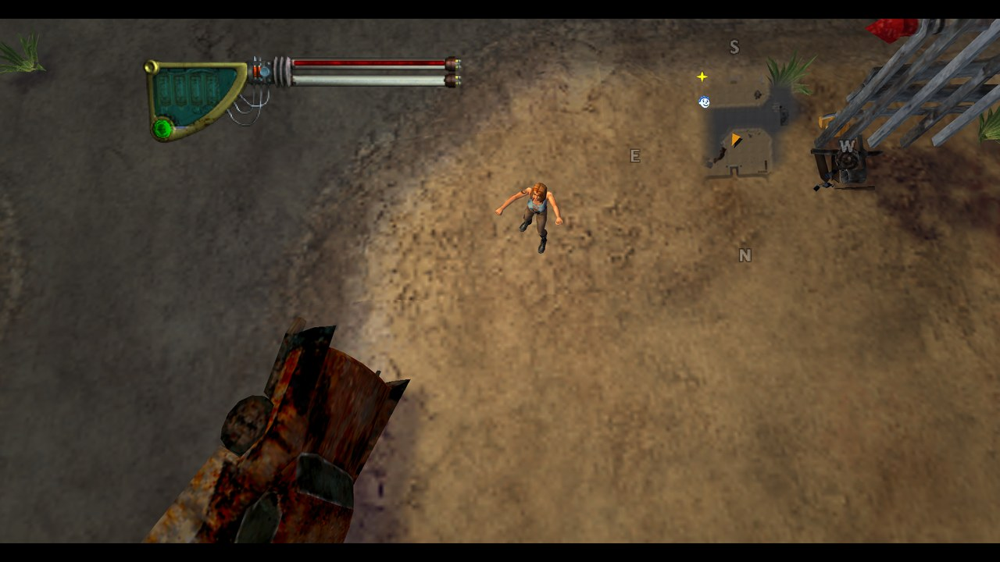
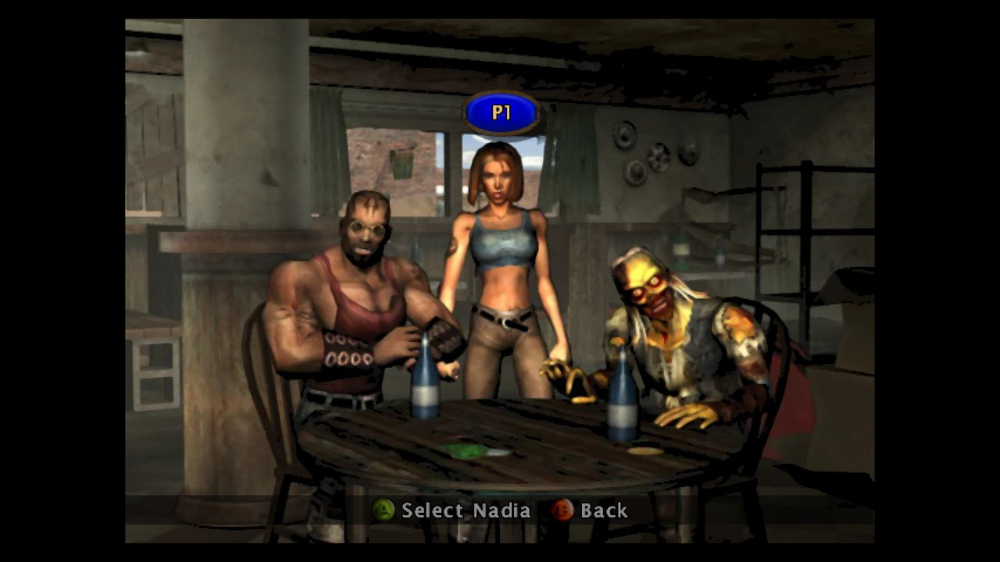

# Fallout: Brotherhood of Steel - PC port

Fallout: Brotherhood of Steel (Xbox, 2004) running natively on Windows.
The game never had a PC version; this is a static recompilation of the Xbox
original, with no emulator, built on [xboxrecomp](https://github.com/Raizhald/xboxrecomp-port).

**You need your own copy of the game** (the USA Xbox disc image, `.iso`).
Nothing from the game is included here: the setup builds the port from your disc.

## How to play

1. **Download** this repository: green **Code** button, **Download ZIP**, and unpack it
   (or `git clone https://github.com/Raizhald/falloutbos-recomp-port`).
2. **Run `Setup.cmd`.** It checks what is needed (Python, Git, CMake, Visual Studio
   C++ build tools) and asks before installing anything. Then it asks for your
   disc image, builds the game and can put shortcuts on the desktop.
   The first run takes about 15-30 minutes; running it again continues where it stopped.
3. **Run `Play.cmd`** (or the desktop shortcut). **`Settings.cmd`** changes the options.

Later, **`Update.cmd`** fetches the newest version and rebuilds it. Your game
files, settings and saves are kept.

Requirements: Windows 10/11 64-bit, a graphics card with Direct3D 11, about 8 GB of disk
space (most of it the C++ build tools).

## Controls

An Xbox controller (XInput) works as on the console. Mouse and keyboard:

| | |
|---|---|
| Move | W A S D (Shift: walk) |
| Aim | mouse - the character turns toward the sight |
| Attack | left mouse button |
| Lock on target | right mouse button (hold) |
| Special attack | F or side mouse button |
| Jump / dodge | Space |
| Talk / open | E |
| Stimpak | Q |
| Next / previous weapon | mouse wheel or R |
| Crouch | C or Ctrl |
| Turn camera | hold middle mouse button and move, or Z / X |
| Map mode | M / N |
| Inventory | Tab or I |
| Pause | Esc |
| Menus | arrows, Enter, Backspace |
| Free the mouse | F9 |
| Full screen | F11 or Alt+Enter |

Keys can be changed in `mkb.ini`.

## Settings

`Settings.cmd` opens a small window:

- **Renderer** - graphics card (Direct3D 11, default) or software
- **Resolution** - 1x to 4x the original 480 lines
- **Texture filtering** - original, smooth or best (bicubic)
- **Aspect ratio** - 4:3 (original), 16:9, 16:10, 21:9; widescreen shows more of the
  world at the sides, menus and videos stay 4:3
- **Silhouette** - the player shows through walls
- **Display mode, window size, frame rate limit, v-sync, controls, mute**

## What has been done

Compared with the Xbox original:

- **Graphics card renderer** (Direct3D 11) with higher resolutions, v-sync and full screen
- **Widescreen** 16:9 / 16:10 / 21:9 with a wider view of the world
- **Texture filtering** - mipmaps and bicubic smoothing
- **Mouse and keyboard** - aiming with the mouse, rebindable keys
- **Player silhouette** behind walls
- Fixed: broken pixels in the videos, crashes and stalls found while testing

## Status

Playable from the start through the first level (Carbon); the rest of the game has
not been played through yet. Expect bugs - please report them in Issues with what
you were doing.

For developers (building by hand, debugging switches, how it works):
[docs/development.md](docs/development.md).

## License

MIT, see [LICENSE](LICENSE). It covers the code in this repository only.
Fallout: Brotherhood of Steel and its data belong to their owners; nothing from the
game is in this repository.

Based on [falloutbos-recomp](https://github.com/sp00nznet/falloutbos-recomp) and
[xboxrecomp](https://github.com/sp00nznet/xboxrecomp) by sp00nznet.
